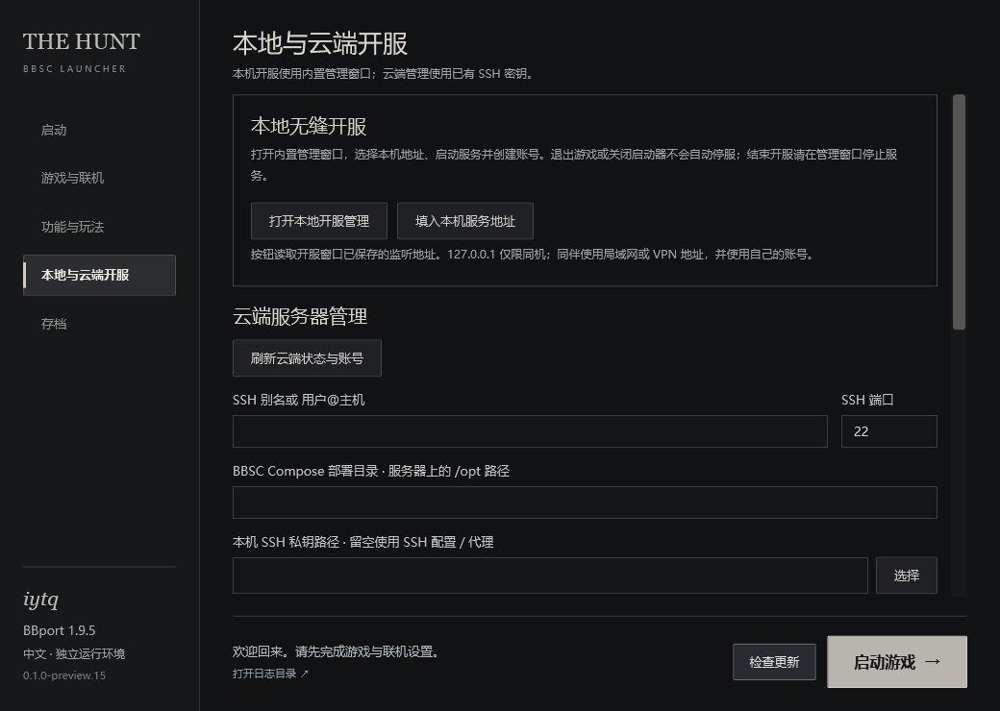

# The Hunt

**Bloodborne PC 无缝联机启动器与开服工具**

preview.18 的启动入口为 `TheHuntLauncher.exe`。从 preview.17 或更早版本切换，请完整解压到新目录；旧版更新助手不能跨越此次更名。详见[入口更名与升级](docs/launcher-entry-rename.md)。

The Hunt 为 BBport 提供中文无缝联机入口，并内置本地开服管理。客户端、独立 Windows 服务端与 Linux 部署配方在本仓库统一维护。

[下载预览版](https://github.com/ytq77/TheHuntLauncher/releases/tag/v0.1.0-preview.18) · [快速开始](#快速开始) · [本地开服](docs/local-server.md) · [Linux 部署](server/docs/deployment.md) · [当前验收状态](docs/validation-current.md)

当前版本为 **0.1.0-preview.18**，基于 **BBport 1.9.6**，仍处于预览阶段。新增独立 SuperMedo 账号和公共在线内容分流，私服继续负责无缝合作。账号认证、公共游戏登录与只读笔记接口已通过协议验证；公共内容的游戏内显示与双人混合联机仍待定向验收。既有 1.9.6 运行及小窗口奖杯验收按未改范围复用；历史灯点问题仍在调查。详见[发布说明](docs/releases/v0.1.0-preview.18.md)与[验收表](docs/validation-current.md)。

## 功能

| 功能 | 说明 |
|---|---|
| 无缝联机 | 使用 BBSC 合作、跨区域召唤、提灯同行及对应猎具；在「功能与玩法」配置玩法和难度 |
| 内置本地开服 | 从启动器打开独立管理窗口，选择监听地址、启停服务和管理联机账号 |
| 独立与云端开服 | 提供独立 Windows 服务端、Linux 部署配方，以及启动器内的 SSH 云端状态与账号管理入口 |
| 奖杯记录与提示 | 显示本体及老猎人共 40 项奖杯，启动和退出时刷新实际记录，新解锁可在游戏右上角提示，随游戏窗口同比缩放 |
| 独立存档 | 无缝进度在独立目录保存，支持带备份的普通版导入与指定布局的离线转换 |
| 本机配置 | 每次启动读取本机普通版的画质及按键配置，账号使用 Windows DPAPI 加密保存 |
| 中文 WPF 界面 | 首页固定文楷，其余页面和开服窗口固定黑体，包含中文联机文本与 PC 菜单适配 |

奖杯只依据真实解锁记录显示，不根据角色进度推算或补发。人偶洗点在无缝版保持关闭。

## 下载

请从 [Releases](https://github.com/ytq77/TheHuntLauncher/releases) 下载完整包，解压到新目录，并使用自己的路径、账号和存档。

| 用途 | 下载内容 |
|---|---|
| 玩无缝联机，也可在本机开服 | `TheHuntLauncher-0.1.0-preview.18-windows-x64.zip`，包含 `server/Server.exe` |
| 专门用一台 Windows 电脑开服 | `TheHuntServer-Windows-v0.1.0-preview.18.zip`，无需安装客户端引擎 |
| Linux / Docker 开服 | `TheHuntServer-Linux-recipe-v0.1.0-preview.18.zip`，按[部署说明](server/docs/deployment.md)准备环境 |
| 查看或构建源码 | `TheHuntLauncher-sources.zip`，以及同版独立服务端源码和图形组件源码附件 |

发布页附 `SHA256SUMS.txt` 和工具链记录。客户端仅发布 TheHuntLauncher 完整包，正常「检查更新」功能保留。

## 快速开始

### 已有可连接的服务器

1. 准备能正常运行的 BBport 普通版及自己的游戏文件。
2. 完整解压客户端，双击 **TheHuntLauncher.exe**。无需单独安装 Python；若电脑缺少 VC++ x64 运行库，可运行包内 `prerequisites/VC_redist.x64.exe`。
3. 在「游戏与联机」选择普通版 `Bloodborne.exe`、游戏 `eboot.bin` 和普通版 `bbport.ini`。
4. 填写服务器管理员提供的四项地址和你的私服联机账号，再填写独立的 SuperMedo 公共账号。保存后点击「启动游戏」；之后自动使用本机加密保存的账号。公共内容与私服合作的区别见[公共在线说明](docs/public-online.md)。

The Hunt 使用所填服务器上的账号，与普通版 SuperMedo 登录分开。联机双方使用兼容版本、同一服务器和不同账号。四项地址的含义见[联机配置](docs/network.md)。

### 在本机开服

1. 打开「本地与云端开服」→「打开本地开服管理」。
2. 在管理窗口选择本机的局域网或 VPN IPv4，启动无缝服务，为每位玩家创建不同账号。
3. 同机游玩可在启动器点击「填入本机服务地址」，再填写账号并保存；同伴使用开服窗口显示的局域网或 VPN 地址。

开服管理窗口独立运行，关闭启动器或退出游戏不会自动停服。结束开服请在管理窗口停止服务或关闭该窗口。地址选择、端口与账号数据位置见[本地开服说明](docs/local-server.md)。

专用 Windows 主机见[服务端说明](server/README.md)，Linux 主机使用[部署教程](server/docs/deployment.md)。已有云端服务可通过启动器的 SSH 管理区域查看状态、新建和验证账号，详见[云端管理](docs/server/client-admin.md)。

## 支持范围

| 组件 | 当前范围 |
|---|---|
| 游戏文件 | CUSA03173 1.09，需自行提供 |
| BBport | 固定 1.9.6 |
| BBSC | 固定 `0.0.1_items`，包含本仓库兼容补丁 |
| 客户端与图形开服窗口 | Windows 10 / 11，x64 |
| Linux 服务端 | 使用同版本部署配方，按文档配置 Docker 与网络 |
| 界面与联机文本 | 简体中文 |

本项目为社区维护项目，由 **iytq** 维护，独立于 BBSC、BBport、Sony 和 FromSoftware。不附带游戏本体、游戏字体或奖杯图片、玩家存档、账号与私人服务器配置。界面字体附带许可，界面图片保留来源记录。

## 存档、奖杯与更新

首次启动会复制本机普通版的存档和模组设置，此后无缝进度在本包 `data/user` 中独立发展。画质和同目录 `input.ini` 每次启动重新读取本机普通版配置。

在「存档」页从普通版导入时，会先备份现有无缝存档，再**整体替换全部角色进度**，不合并世界进度。「无缝版 → 普通版」提供带备份的离线转换，当前仅支持已验证布局和条件。操作前请阅读[导入与转换说明](docs/save-conversion.md)。

导入与转换会备份并合并实际奖杯记录，按编号去重、保留最早解锁时间。原版未记录的历史奖杯不会仅凭存档进度自动点亮，见[奖杯同步](docs/trophies.md)。

「检查更新」支持查询、下载校验、程序备份与替换，并保留账号和存档，见[自动更新](docs/updates.md)。合作结束后的世界恢复说明见[世界恢复流程](docs/world-recovery.md)；保留待确认记录，按提示关闭游戏并完成核对。

## 文档与源码

- [玩法与功能开关](docs/features.md)
- [本地开服](docs/local-server.md)、[Windows 服务端](server/README.md)、[Linux 部署](server/docs/deployment.md)、[网络配置](docs/network.md)
- [当前验收表](docs/validation-current.md)、[历史灯点调查](docs/lamp-investigation.md)
- [C# WPF 与奖杯实现](docs/desktop-wpf.md)、[BBport 1.9.6 适配](docs/upstream-1.9.6-review.md)
- [源码构建](docs/build.md)、[贡献指南](CONTRIBUTING.md)

`launcher/` 为客户端前台与后端，`server/` 为服务端，`patches/` 为兼容与修复补丁。原 [TheHuntServer](https://github.com/ytq77/TheHuntServer) 仓库只读保留历史，新版本统一在本仓库维护和发布。

GitHub Actions 执行自动检查和构建，`v*` 标签生成预发布版并附带匹配源码和校验文件。上游提交固定在 `upstream.lock.json`；工具链版本记录在发布附件中。

## 致谢与许可证

- [CLSAMG22 / BBSC](https://github.com/CLSAMG22/BBSC)：无缝联机主体、加载器、服务器与猎具机制。
- [Supermedo / bloodborne_pc](https://github.com/Supermedo/bloodborne_pc)：BBport 核心、画面和输入支持。
- [shadPS4](https://github.com/shadps4-emu/shadPS4)、[MSYS2](https://www.msys2.org/) 及各依赖项目的贡献者。

本项目代码使用 GPL-2.0-or-later；第三方代码和资源保留各自许可证与署名。详见 [LICENSE](LICENSE) 与 [NOTICE.md](NOTICE.md)。
