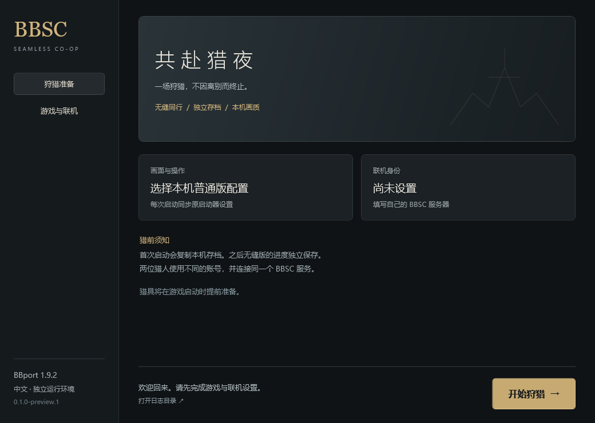

# The Hunt — BBSC Launcher

由 **iytq** 维护，适用于 Bloodborne PC 移植版的 BBSC 无缝联机启动器，提供独立运行环境、中文文本、本机配置同步与自动构建。

A Windows launcher and compatibility layer for BBSC seamless co-op on BBport. This is a community project, independent of the original BBSC, BBport, Sony and FromSoftware projects.

## 当前支持

| 组件 | 固定版本 |
|---|---|
| 游戏 | CUSA03173 1.09，自备游戏文件 |
| BBport | 1.9.2 |
| BBSC | 0.0.1_items，包含本仓库兼容补丁 |
| 系统 | Windows 10 / 11，x64 |
| 界面与模组文本 | 简体中文 |

这是 **0.1.0 预览版**。现有兼容基线已实测双人移动、战斗、死亡后保持联机及提灯同行。新启动器已完成单机启动实测，猎具在进入角色前准备完成，五件道具的分类、中文与图标均经确认；新构建的完整双人回归及 Boss 战结束后的联机保持尚待验证。

## 使用

1. 从 [Actions](https://github.com/ytq77/bbsc-launcher/actions) 下载构建产物，或从 [Releases](https://github.com/ytq77/bbsc-launcher/releases) 下载预览版。完整解压到新目录。
2. 双击 **BBSC-Launcher.exe**。无需安装 Python 或修改普通版启动器。
3. 在「游戏与联机」选择本机普通版 `Bloodborne.exe`、游戏 `eboot.bin` 以及普通版的 `bbport.ini`。
4. 填写服务器管理员提供的四个联机地址与个人账号，保存后点击「启动游戏」。

需要先有能正常运行的 BBport 普通版。首次启动会复制本机存档、输入配置与模组设置，此后无缝版存档保存在本包 `data/user` 中独立发展。普通版画质和帧率设置在每次启动时重新读取，因此低配置电脑不会继承其他电脑的画质。

本项目不附带游戏本体、游戏字体/资源、存档、账号或私人服务器配置。游戏主体的汉化来自用户自己的游戏安装；BBSC 道具、联机提示由本项目提供中文文本。

## 从普通版更新存档

首次启动自动复制普通版存档。之后普通版进度增加时，先正常退出游戏，在「存档」页核对来源和目标，再点击「从普通版导入」。

导入会校验文件，自动将现有无缝存档备份到本包 `save-backups/`，再用普通版存档**整体替换全部角色**，不合并进度。普通版存档保持原样，画质和联机配置不受影响。游戏运行时禁止导入；复制或切换失败会保留或恢复原无缝存档。备份不会自动删除，可从同页打开备份目录。

这是单向导入。当前 BBSC 会替换原版联机道具及相关领取状态，尚未验证无缝存档回迁普通版的完整兼容性。

## 联机

需要支持 BBSC 的 **shadNet + BBSC 游戏服务/Relay**。单有普通 shadNet 服务不等于已经具备无缝联机服务。地址字段的意义及配置示例见 [联机配置](docs/network.md)；自行部署、维护与排错见 [Ubuntu / Docker / Tailscale 服务端教程](docs/server/README.md)。

两端使用兼容版本、同一个服务器和不同账号。服务端与路由环境仍由服务器管理员维护；本启动器不会自动修改路由器、防火墙或部署服务器。

| 猎具 | 用途 |
|---|---|
| 唤猎之铃 | 召来其他猎人，成为房主 |
| 应猎之铃 | 加入另一位猎人的世界 |
| 渴血之铃 | 入侵其他猎人的世界 |
| 纷争之铃 | 在合作会话中切换玩家间战斗 |
| 断鸣空弹 | 结束合作 |

## 本仓库的改动

- The Hunt 图形启动器：旧银色、铃铛蚀刻纹样与 iytq 署名，显示当前配置、启动状态和猎具准备耗时。
- 深色标题栏、原创铃铛程序图标、清晰的页面选中状态与按需存档导入。
- 把猎具初始化从读档后的首次游戏循环提前到安装钩子阶段，取消首次 5 秒等待；保留失败重试与未就绪保护。
- 用安全的内存快照扫描处理页面权限变化，避免扫描时触发宿主的致命异常处理。
- 排除独立环境下重复加载的内置补丁 XML，保留玩家选择的其他补丁。
- 每次启动同步本机画质设置，账号通过 Windows DPAPI 按当前用户加密保存。
- 210 条道具/菜单文本、18 处运行时提示及动态 Boss 提示的简体中文翻译。

## 构建与贡献

见 [构建说明](docs/build.md)、[验证记录](docs/validation.md) 和 [贡献指南](CONTRIBUTING.md)。

GitHub Actions 在推送、PR 和手动触发时执行测试与 Windows 构建。版本标签 `v*` 生成 GitHub **预发布版**，同时附带二进制、完整应用源码和 SHA256 校验文件。上游源码固定到 `upstream.lock.json` 中的提交，升级需要显式修改并重新验证；MSYS2 工具链版本会记录在产物中，当前不承诺逐字节可重现。

## 致谢与许可证

- [CLSAMG22 / BBSC](https://github.com/CLSAMG22/BBSC)：无缝联机主体、加载器、服务器及原始道具机制。
- [Supermedo / bloodborne_pc](https://github.com/Supermedo/bloodborne_pc)：BBport 核心、画面与输入支持。
- [shadPS4](https://github.com/shadps4-emu/shadPS4) 及上游贡献者。
- [MSYS2](https://www.msys2.org/) 与各依赖项目。

本项目代码使用 GPL-2.0-or-later；第三方代码保留原许可证和署名。详见 [LICENSE](LICENSE) 与 [NOTICE.md](NOTICE.md)。不宣称拥有上游项目或 Bloodborne 游戏资产。
